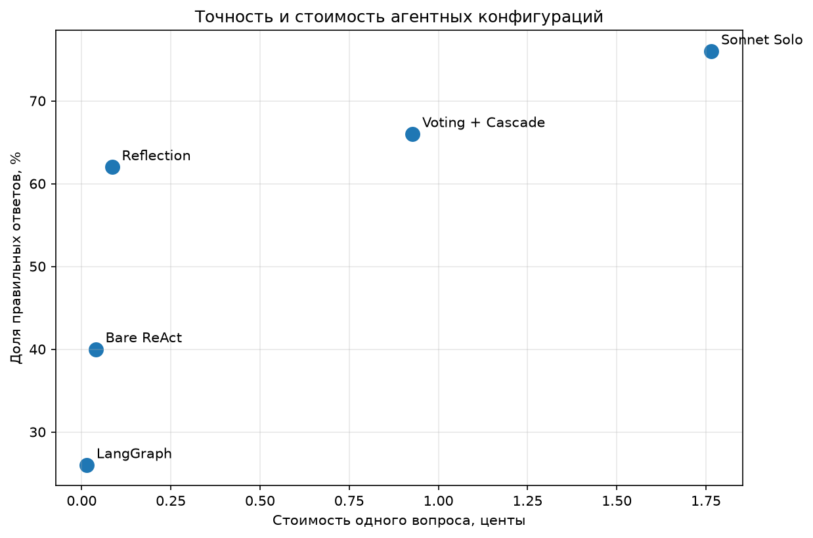

# MediaAgent Eval

Домашняя работа 3: сравнение нескольких вариантов AI-агента на вопросах о музыке, фильмах и сериалах.

Я взяла агента с инструментами поиска из предыдущей работы и проверила, что изменится, если перенести его на LangGraph, добавить проверку ответов критиком или голосование с переходом к более сильной модели. Сравнивала не только точность, но и количество вызовов и реальную стоимость запросов через OpenRouter.

## Данные и реализация

В `data/questions.jsonl` - 50 вопросов с эталонными ответами: 20 о музыке, 20 о кино и 10 о сериалах. Половина относится к событиям 2026 года, половина - к событиям до 2024 года.

У агента два инструмента, работающих с англоязычной Википедией:

- `web_search(query)` - ищет статьи и возвращает начало наиболее подходящей;
- `page_find(title, keywords)` - ищет нужные фрагменты внутри статьи.

Для обычных запусков использовала `openai/gpt-4o-mini`, для эскалации и отдельного сравнения - `anthropic/claude-sonnet-4.6`. У базового цикла и LangGraph одинаковые системный промпт, модели и инструменты.

Все обращения к моделям проходят через общий `httpx.Client`. Обработчик ответа записывает метку эксперимента, модель, число входных и выходных токенов и `usage.cost`. Цены ниже указаны в центах , а не в долларах.

Правильность ответа проверяется функцией `is_correct()`: она нормализует текст и ищет в ответе все слова из эталона. Проверка простая и не всегда учитывает переводы или разные формы названий, поэтому я отдельно просмотрела часть ошибок вручную.

## Какие варианты сравнивала

| Вариант | Как работает |
|---|---|
| **Bare ReAct** | Собственный цикл вызова модели и инструментов, максимум 5 шагов |
| **LangGraph** | Тот же агент через `create_agent`; добавлен `last_step_without_tools`, чтобы модель завершала ответ без новых инструментов |
| **Reflection** | После ответа отдельный критик проверяет его по найденным фрагментам Википедии. Если доказательств недостаточно, агент пробует ещё раз (не более двух проходов всего) |
| **Voting + Cascade** | Три прогона GPT-4o-mini при `temperature=0.7`. При полном совпадении ответов берётся их результат, иначе вопрос передаётся Sonnet |
| **Sonnet Solo** | Sonnet отвечает без голосования, с теми же инструментами |

Для паттернов я оставила LangGraph. В первом сравнении он дал меньшую точность, чем Bare ReAct, зато оказался дешевле в расчёте на правильный ответ. Это было основанием продолжить эксперименты именно с ним.

## Результаты

| Конфигурация | Верно | Accuracy | Вызовов/вопрос | Токенов/вопрос | Центов/вопрос | Центов/верный |
|---|---:|---:|---:|---:|---:|---:|
| Bare ReAct | 20/50 | 40% | 4,50 | 2 394 | 0,0399 | 0,0999 |
| LangGraph | 13/50 | 26% | 1,90 | 853 | 0,0147 | **0,0567** |
| Reflection | 31/50 | 62% | 7,70 | 5 368 | 0,0857 | 0,1382 |
| Voting + Cascade | 33/50 | 66% | 14,02 | 10 174,9 | 0,9280 | 1,4060 |
| Sonnet Solo | **38/50** | **76%** | 3,76 | 4 889,8 | 1,7656 | 2,3232 |



Таблица сохранена в [`results/summary.csv`](results/summary.csv). Это показатели отдельных экспериментов на одном наборе из 50 вопросов. После ручной проверки я не меняла исходные значения Accuracy, чтобы результаты соответствовали сохранённым прогонам.

### LangGraph: что добавляет фреймворк

Проверила первые HTTP-запросы на простом вопросе `What is 2 + 2? Reply with the number only.` Оба агента ответили `4`.

| Первый запрос | Bare ReAct | LangGraph |
|---|---:|---:|
| Входных токенов | 241 | 223 |
| Размер тела запроса | 1 443 байта | 1 365 байт |
| Сообщений | 2 | 2 |
| Инструментов | 2 | 2 |

Запросы не совпадают побайтово, хотя модель и сообщения одинаковые. Разница в основном в описании инструментов: LangGraph убирает вспомогательные поля `title` из JSON-схем, добавляет `stream: false` и чуть иначе оформляет текст описаний. Описания самих аргументов не потерялись - они явно заданы через Pydantic `args_schema`.

В моём случае LangGraph отправил **на 18 входных токенов меньше**. Это не значит, что фреймворк всегда дешевле: здесь сравниваются конкретные первые запросы. LangGraph удобен тем, что сам организует вызовы инструментов и переходы между ними, но для остановки агента мне всё равно понадобился `last_step_without_tools` - без него возникала ошибка лимита рекурсии.

### Reflection: помог ли критик

Критик получает ответ и выдержки, которые агент нашёл через инструменты. Он возвращает структурированный вердикт `supported` / `issue` и при отсутствии подтверждения может отправить вопрос на повторный поиск. Сам эталонный ответ ему не передаётся.

Первый полный прогон оказался неудачным из-за HTTP 429 от Википедии. Я добавила кэширование запросов, повторы с задержками и увеличила объём текста для критика (до 2 000 символов на результат инструмента и 8 000 суммарно). После этого повторный прогон завершился без технических ошибок: **31/50, или 62%**.

Для подсчёта *Fixed/Broken* понадобились ответы обычного LangGraph по каждому `id`. Они не сохранились после первого эксперимента, поэтому я отдельно повторила прогон без критика и сохранила его в `langgraph_fixed_paired.csv`.

| Показатель | Результат |
|---|---:|
| Fixed - неверно без критика, верно с ним | **2** |
| Broken - верно без критика, неверно с ним | **0** |
| Чистая разница | **+2** |

Здесь важно не путать результаты: **26%** для LangGraph в общей таблице - это первоначальный эксперимент, а для Fixed/Broken использовался **другой прогон**, в котором LangGraph получил **29/50 (58%)**. Reflection получил 31/50. Поскольку ответы генерировались отдельно, разница в два вопроса не обязательно объясняется только работой критика.

Данные: [`langgraph_critic_v2.csv`](results/langgraph_critic_v2.csv) и [`langgraph_fixed_paired.csv`](results/langgraph_fixed_paired.csv).

### Voting + Cascade: стоит ли голосование своих денег

Три голоса сравниваются по нормализованному тексту. Если совпали все три, каскад завершает работу; если хотя бы один отличается, вызывается Sonnet. Это довольно строгое условие: два одинаковых ответа из трёх всё равно приводят к эскалации.

В результате **23 из 50 вопросов (46%)** ушли на сильную модель. Каскад дал **33/50 (66%)**, Sonnet без каскада - **38/50 (76%)**.

По цене правильного ответа каскад выгоднее: **1,4060 цента против 2,3232 цента** у Sonnet, то есть примерно на **39,5% дешевле**. Но за эту экономию мы теряем 10 процентных пунктов точности. Кроме того, три полноценных прогона на каждый вопрос сильно увеличивают число вызовов - в среднем до **14,02**.

Данные: [`cascade_v1.csv`](results/cascade_v1.csv), [`sonnet_solo.csv`](results/sonnet_solo.csv). Во время экспериментов встречались ошибки API; после исправлений я продолжала с сохранённых CSV, не повторяя успешно обработанные вопросы.

## Проверка проверки

Я вручную посмотрела ответы, которые `is_correct()` отметила как неверные.

Для Bare ReAct проверила 10 таких ответов. Все были отказами `I don't know`, ложных ошибок метрики в этой десятке не нашла.

Для Reflection выбрала случайные 10 неверных по автоматической оценке (`random_state=42`). **В девяти случаях оценка была верной, в одном - ошибочной**:

- `film-2026-09`: в эталоне указано *Gelbe Briefe*, а агент ответил *Yellow Letters*. Это два названия одного фильма, поэтому ответ следует считать правильным.
- `music-2026-07`: агент указал *Olivia Dean*, хотя спрашивали название альбома (*The Art of Loving*). Такой ответ действительно неполный.

Остальные восемь ответов из выбранной десятки были `I don't know`. Получилось **1 ложноотрицательное срабатывание из 10 проверенных**. Это не означает, что 10% всех ответов оценены неверно: выборка небольшая. Исходные эталоны и метрики экспериментов я не переписывала. Ручные отметки находятся в [`results/manual_audit.csv`](results/manual_audit.csv).

## Ограничение числа вызовов

Отдельно проверила `ModelCallLimitMiddleware(run_limit=2, exit_behavior="end")` на вопросе о двух номинациях Grammy 2026. Агент сделал ровно **2 вызова модели**, после чего вернул:

```text
Model call limits exceeded: run limit (2/2)
```

То есть ограничение сработало на уровне кода, а не только через просьбу в промпте. Содержательного ответа на этом тесте агент дать не успел. Этот лимит демонстрируется отдельной ячейкой ноутбука; он не был включён во все основные прогоны.

## Как запустить

Использовался **Python 3.11**. Необходимы:  API-ключ OpenRouter и зависимости из `requirements.txt`.

В корне репозитория:

```bash
conda create -n agents python=3.11 -y
conda activate agents
pip install -r requirements.txt
```

Создайте `.env` по образцу `.env.example` и укажите ключ:

```dotenv
OPENROUTER_API_KEY=your_key_here
```

Затем откройте `media_agent_eval.ipynb` . Рабочая папка должна быть корнем репозитория: оттуда ноутбук читает `data/questions.jsonl`, `.env` и каталог `results/`.

Основные файлы проекта:

```text
media-agent-eval/
├── media_agent_eval.ipynb
├── data/
│   └── questions.jsonl
├── results/
│   ├── summary.csv
│   ├── accuracy_cost.png
│   ├── langgraph_critic_v2.csv
│   ├── langgraph_fixed_paired.csv
│   ├── cascade_v1.csv
│   ├── sonnet_solo.csv
│   └── manual_audit.csv
├── .env.example
├── requirements.txt
└── README.md
```

В `results/` также лежат логи вызовов критика и файл его первого, неудачного прогона. Итоговые результаты уже сохранены в CSV и показаны в ноутбуке: повторно запускать все платные эксперименты только ради просмотра таблиц не требуется. Если выполнять ноутбук с нуля, результаты могут немного отличаться, а Википедия иногда отвечает HTTP 429 или сообщает о перегрузке поиска.


## Выводы

1. **Проверка ответа по источникам оказалась полезной:** Reflection дал 62% против 26% в первом прогоне LangGraph. Наибольшую точность показал Sonnet - 76%, но он заметно дороже.
2. **Голосование оказалось дорогим по числу запросов:** Cascade дал 66% при 14,02 вызова на вопрос. По цене правильного ответа он выгоднее постоянного Sonnet, но уступает ему по точности на 10 процентных пунктов.
